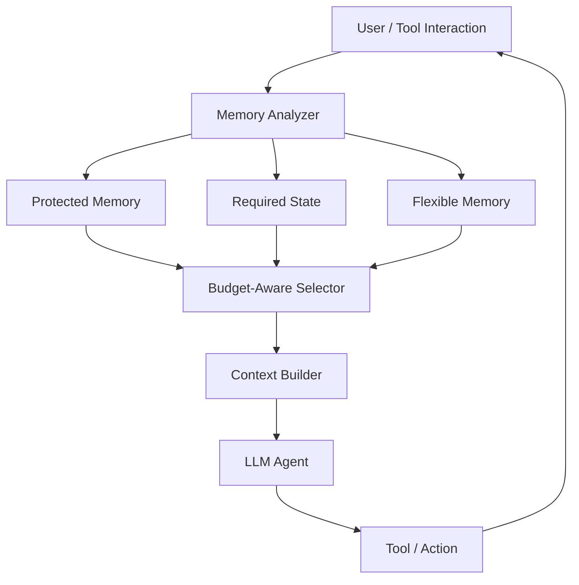

# Constraint-Preserving Budget-Aware Memory

**Long-Horizon LLM Agent를 위한 제약 보존 및 Token Budget 기반 메모리 관리**

2026-2 HAI Project · Team 1

장기간 동작하는 LLM Agent가 제한된 Context 안에서도 반드시 지켜야 하는 제약과 현재 Task에 필요한 상태를 유지하도록 하는 Memory Architecture를 연구한다. Calendar, Email, File, Task 등의 가상 Tool을 사용하는 자체 Testbed를 구축하고, 메모리 선택이 실제 Agent의 행동과 작업 성공률에 미치는 영향을 평가한다.

> V1 실행 파이프라인 구현과 필수 Main 12셀 실험을 완료했다. 인메모리 Memory Store와 State Versioning, 공용 semantic retrieval, 규칙 기반 Query Analyzer, Version/Temporal/Protected/Required-State Resolution과 예산 기반 Proposed Selector, 세 Baseline, Context 조립·최종 Budget Validation, 결정적 규칙 Planner와 Gemini LLM Planner, 다단계 Orchestrator, PipelineAdapter 기반 Benchmark Runner와 Evaluator가 구현되어 있다. Proposed 전략과 네 가지 구성 요소 Ablation preset도 Snapshot Memory Store를 통해 Runner에 연결되어 있으며 Selector·Runner 통합 테스트를 제공한다. 실험 설정 기반 temporal_update/approval 생성기와 Gemini CountTokens의 메모리·SQLite 캐시, 재시도, 실행별 캐시 격리도 제공한다. LLM 실행에서는 출력 토큰·비용·planning latency를 누적 기록한다. 과거 State와 현재 행동 Constraint를 동시에 요구하는 복합 경로의 전용 통합 검증은 아직 남아 있다.

## 배경과 목표

긴 Interaction History 전체를 Context에 넣으면 Token 비용이 증가하고, 제한된 예산에서는 모든 정보를 유지하기 어렵다. 단순 검색이나 최근 기록 중심의 선택은 과거에 주어진 행동 제약을 누락하거나 이미 변경된 상태를 반환할 수 있다.

본 프로젝트의 핵심 질문은 “모든 과거 정보를 기억할 수 없는 Agent는 무엇을 반드시 기억해야 올바른 행동을 유지할 수 있는가?”이다.

- 동일한 Context Token Budget에서 높은 Task Success Rate 유지
- 중요한 제약과 Task가 요구한 시점의 상태를 보존하여 Constraint Violation 및 오래된 State 사용 감소
- Full Context 대비 Token 사용량과 비용의 관계 분석
- 실제 Tool 호출 결과를 통한 행동 수준의 메모리 평가

## 본실험 결과 (2026-11-09)

Freeze **1.0.3**으로 Horizon **10/50/100 × 입력 Budget 1K/2K/4K/8K**의
12셀·**3,840회** 비교 실험을 완료했다. 셀마다 공통 과제 40개 × 네 전략 × 두 반복을
실행했으며, 각 전략·셀의 성공률은 80회 기준이다. 아래에서 묶어 표시한 조건도
각각 같은 결과였다는 뜻이며, 독립 표본을 합쳐 센 것이 아니다.

| 입력 Budget | Horizon | Proposed | Sliding Window | Vector Top-k | Utility-per-Token |
|---|---|---:|---:|---:|---:|
| 1K | 10 / 50 / 100 | 0% | 0% | 0% | 0% |
| 2K | 10 | **97.5%** | 82.5% | 87.5% | 87.5% |
| 2K | 50 / 100 | **97.5%** | 72.5% | 87.5% | 87.5% |
| 4K / 8K | 10 / 50 / 100 | 97.5% | **100%** | 87.5% | 87.5% |

- **제한 예산에서의 이점:** 2K에서 Proposed는 Sliding보다 15~25%p 높았다.
  동일 과제를 묶은 paired bootstrap 95% 구간도 이 비교에서는 0을 포함하지 않았다.
- **큰 예산에서의 성능·비용 절충:** 4K·8K에서는 Sliding이 더 높았다.
  Proposed는 실행당 누적 입력을 약 40% 적게 사용했지만 성공률도 2.5%p 낮았다.
  전 조건의 우월성이나 같은 성능에서의 비용 절감으로 해석하지 않는다.
- **실패 원인:** 1K의 Proposed 240회는 필수 기억 예산 부족으로 안전 중단했다.
  2K 이상 실패 18회는 같은 기본 과제 하나에서 정답 기억을 보존했지만
  승인 요청의 `attachment` 인자를 빠뜨린 사례다. Vector/Utility는 같은 기본 과제
  5개에서 최신 버전이 검색 후보에 없어 이전 파일을 사용했다.
- **Horizon 해석:** 성공률 변화는 주로 2K Sliding에 나타났으며 H50/H100은 같았다.
  주어진 합성 Memory snapshot에서의 결과를 일반적인 장기 대화 기억 능력으로 확장하지 않는다.
- **기록 품질과 비용 한계:** 생성 응답 7,450개는 모두 `STOP`이었고 출력 잘림·해석 오류·
  실제 입력 예산 초과는 0건이었다. H100·2K의 3개 실행은 재시도 후 비용이 `null`이다.
  알려진 비용의 부분합을 전체 실험 청구액으로 보고하지 않는다.

모든 차수는 같은 commit `5d00c6d`에서 Gemini 3.1 Flash-Lite, temperature 0,
thinking LOW, 출력 상한 2,048, top-k 5, max_steps 8, 입력 safety margin 32를 유지했다.
기본 과제는 40개이며 3,840개의 독립 과제를 평가한 것은 아니다.
12셀 전체 표·신뢰구간·실패 사례는 [Experiment Plan의 최종 결과](docs/experiments/plans/experiment-plan.md#17-전체-main-최종-결과-2026-11-09)와
[최종 분석 보고서](docs/experiments/reports/main-final-analysis-2026-11-09.md)를 따른다.

2026-11-10에는 Horizon 채움 문체의 retrieval 민감도를 별도로 점검했다. Budget 2K,
Horizon 100의 paired scenario 40개에서 기존 반복 Mode 1, 로컬 자연어 Mode 2,
50:50 혼합 Mode 3을 비교한 결과, Mode 1→2의 State Recall@5는 baseline에서
`87.5%→80.0%`, Proposed 일반 후보군에서 `90.0%→80.0%`로 변했다. 이는 offline
retrieval audit이며 Agent TSR 결과가 아니다. 범위와 한계는
[Horizon Narrative Retrieval Bias Audit](docs/experiments/audits/narrative-bias-audit-2026-11-10.md)에 기록한다.

2026-11-11의 후속 2×2 factorial audit에서는 required State padding과 synthetic noise
padding을 독립적으로 교체했다. 관측된 Recall 차이는 target padding 교체에서만
나타났고(baseline −7.5%p, Proposed 일반 후보군 −10.0%p), noise 교체와 interaction은
0이었다. 두 target 효과의 bootstrap 구간은 0을 포함하거나 경계에 닿으므로 확정적
일반 효과로 표현하지 않는다. 자세한 설계와 해석은
[Narrative Padding 2×2 Factorial Audit](docs/experiments/audits/narrative-factorial-audit-2026-11-11.md)을 따른다.

같은 입력의 Mode 1/2를 실제 Proposed 선택기와 Context Builder까지 확인한 후속 audit에서는
Mode 2의 초기 Required State hit가 80%(Mode 1: 90%)였지만, 두 모드 모두 version chain
확장 뒤 정답 State와 적용 제약을 최종 Context에 100% 포함했다. 이는 LLM 호출 전 단계
검증으로 TSR 결과가 아니다. [Final Context Audit 보고서](docs/experiments/audits/narrative-final-context-audit-2026-11-11.md)에
단계별 수치와 제한을 기록했다.

이어 같은 Mode 1/2 paired 과제에서 Gemini Agent를 실행한 결과 Proposed TSR은 각각
97.5%(39/40), 100%(40/40), Vector Top-k는 87.5%(35/40), 80%(32/40)였다. 적용 승인
과제의 Constraint Violation은 모두 0/20이었다. 이는 실제 Tool 행동을 포함한 단일 실행
평가이며, 범위와 반복 한계는 [Narrative Mode 1/2 LLM 실행 보고서](docs/experiments/audits/narrative-llm-execution-audit-2026-11-11.md)에 기록했다.

별도 attachment 재점검에서는 같은 승인 과제 하나를 Mode별 5회 실행했다. Mode 1은 검색·선택된
정답 상태가 Context에 있었지만 `request_approval`의 `attachment`를 5회 모두 생략했고,
Mode 2는 5회 모두 올바른 파일을 첨부했다. 이는 단일 과제 진단으로 일반적인 Mode 효과를
뜻하지 않는다. [재점검 보고서](docs/experiments/audits/attachment-recheck-2026-11-11.md)를 참고한다.

같은 날 수행한 Ablation은 2K와 4K/Horizon 100의 각 400회, 총 800회 실행이다. 두 예산 결과는
모든 대응 실행에서 성공률, Agent 응답·도구 호출, 선택 기억, 입력·출력 tokens와 비용이
일치했다. 실제 입력 최대치가 1,822 tokens로 2K 유효 예산 안에 있어, 이번 과제 집합에서는
예산을 2K에서 4K로 올려도 관측 결과가 달라지지 않았다. Temporal 기능 제거에서는 성공률
저하와 stale-state 사용이 나타났고, Constraint Preservation 제거에서는 성공률 100%와 보호
기억 recall 90%가 함께 관측됐다. 두 실행의 OS와 commit이 달라 latency는 직접 비교하지 않는다.
상세 결과와 한계는
[Ablation 보고서](docs/experiments/reports/ablation-2k-h100-analysis-2026-11-11.md) 및
[Experiment Plan 23절](docs/experiments/plans/experiment-plan.md#23-ablation-2k-horizon-100-실행-2026-11-11)을 따른다.

PR에서 확인할 수 있는 [집계 JSON·감사 결과·그래프](docs/results/main_20261109/README.md)도 함께 보존한다.

## 제안 메모리 구조

| 구성 요소 | 보존할 정보 | 관리 방식 |
| --- | --- | --- |
| **Protected Memory** | 외부 발송 전 승인, 수행 금지 작업, 예산·권한 등 행동 제약 | 일반 Memory Ranking보다 우선하여 보존 |
| **Required State** | Task가 요구하는 시점에 유효한 파일, 일정, 작업 상태 등 | Version-Aware State Resolution으로 현재·과거 버전 선택 |
| **Flexible Memory** | 과거 경험, 선호, 참고 정보 등 | 남은 예산에서 관련성·중요도·최신성·Token Cost를 고려하여 선택 |

예를 들어 보고서가 `report_v1.pdf`에서 `report_final.pdf`로 변경되면, 이전 파일은 `SUPERSEDED`, 최신 파일은 `ACTIVE`로 관리한다.



### Budget-Aware Selection

전체 입력 Context Budget을 `B`, 공통 지시문·현재 요청·Tool 정의 등의 고정 비용을 `C_fixed`, Protected Memory와 Required State의 비용을 `C_P`라고 하면 Flexible Memory에 사용할 수 있는 예산은 다음과 같다.

```text
B_flex = B - C_fixed - C_P

maximize  Σ U_i × x_i
subject to Σ C_i × x_i ≤ B_flex,  x_i ∈ {0, 1}
```

필수 정보가 예산을 넘으면 `INSUFFICIENT_CONTEXT_BUDGET`으로 중단하고 LLM과 Tool을 호출하지 않는다.

`U_i`는 Memory 항목의 효용, `C_i`는 Token 비용, `x_i`는 선택 여부이다. 필수 정보를 먼저 배치하고 남은 예산에서 Flexible Memory의 효용을 최적화한다. 필수 정보 자체가 예산을 초과하는 조건은 별도로 기록하여 보존 가능 범위와 한계를 평가한다.

`context/builder.py`는 선택 결과를 실제 Prompt로 조립한 뒤 전체 입력을 다시 측정한다. Formatting overhead로 예산을 넘으면 우선순위가 가장 낮은 Flexible Memory부터 제거하고 재조립·재측정을 반복한다. 모든 Flexible Memory를 제거해도 초과하면 `INSUFFICIENT_CONTEXT_BUDGET`을 반환한다. `context/tokenizer.py`는 공용 `TokenCounter`와 반환값 검증을 담당한다.

결과 재현성 정보는 `experiment.json`, `runs.jsonl`의 각 행, Runner 반환값(CLI stdout JSON)에 함께 기록한다.

- `git_commit`: 실행 시작 시 checkout의 HEAD SHA. `git_dirty`는 tracked 파일의 미커밋 변경 여부이며, Git 정보를 읽을 수 없으면 두 값은 `null`이다. 기존 `resume_identity.code`는 실제 소스 내용의 해시를 보존한다.
- `runtime_environment`: Python 구현·버전·실행 파일, OS·machine, `google-genai`·`sentence-transformers`·`transformers`·`huggingface-hub`·`torch` 버전과 embedder 정보를 기록한다. 표준 다국어 embedder는 Hugging Face cache에서 확인한 실제 snapshot revision과 정규화·사전 로드 여부도 남긴다.
- `request_token_safety_margin`: provider usage와 CountTokens 사이의 작은 차이를 흡수하기 위해 명목 Context Budget에서 미리 빼는 값이다. 기본값은 `0`이며, 설정 또는 `--request-token-safety-margin`으로 지정하면 모든 전략이 동일한 실효 Budget을 사용한다.
- `prompt_checksums`: 실행에 넘긴 `system_prompt`, `tool_definitions`, LLM의 실제 `system_instruction` 문자열을 각각 UTF-8로 인코딩한 SHA-256. 공백과 개행을 포함하며, `llm_config`가 없으면 `system_instruction`은 `null`이다.
- `bootstrap_seed`: 집계 신뢰구간 계산에 사용하는 `--seed` 값. `dataset_seeds`는 선택된 시나리오의 `metadata.seed` 목록이며, 각 결과 행의 `dataset_seed`는 해당 시나리오의 값이다. 생성 seed가 없는 입력은 행에 `null`로 기록하고 목록에서는 제외한다. 현재 LLM 요청에는 seed를 전달하지 않는다.

Freeze checksum 대상인 `experiments/prompts/system_v1.txt`, `experiments/prompts/tools_v1.txt`, `docs/algorithm.md`는 `.gitattributes`에서 LF로 고정한다. Runner는 checkout된 원본 바이트의 SHA-256을 검증하므로 Windows와 Linux에서 개행 변환 때문에 같은 freeze가 다르게 판정되지 않는다.

## 연구 질문

1. **RQ1:** 동일한 Context Token Budget에서 Proposed가 기존 기억 방식보다 실제 Tool 행동을 포함한 작업 성공률(Action-Level TSR)을 높이는가?
2. **RQ2:** Budget이 감소하거나 중요한 정보와 Task 사이의 거리(Horizon)가 증가할 때 Proposed가 제약 위반과 잘못된 State 사용을 더 잘 억제하는가?

기준 문서는 [Research Questions](docs/research/research-questions.md)이다. 현재 Task에 필요한 State는 항상 최신 버전을 뜻하지 않는다. Historical Query에서는 요청 시점에 유효했던 과거 버전이 정답이다.

## 실험 계획

동일한 Agent와 Task 조건에서 Memory Policy를 변경하여 비교한다.

| 비교 방식 | Context 구성 |
| --- | --- |
| Full Context | 전체 Interaction History 제공 |
| Sliding Window | 최근 History 중심으로 제공 |
| Vector Top-k Memory | 벡터 유사도에 따라 검색한 Memory 제공 |
| Utility-per-Token Memory | Token 비용 대비 효용을 기준으로 Memory 선택 |
| Proposed | 제약과 Required State를 우선 보존하고 남은 예산을 효용 기반으로 할당 |

동일 예산 비교는 각 방식의 입력이 예산 내에 들어가도록 수행한다. 전체 History가 예산을 초과하는 Full Context 실행은 별도의 비용·성능 참고 기준으로 보고한다.

### 자체 Long-Horizon Agent Testbed

가상 Calendar, Email, File, Task Tool을 제공하고 다음 조건을 조절한다.

| 실험 | 조절 조건 | 확인할 내용 |
| --- | --- | --- |
| Token Budget Scaling | 1K / 2K / 4K / 8K 등 | 예산 감소에 따른 성능과 오류 변화 |
| State Change | 동일 정보의 변경 횟수 | 최신 상태 활용 능력 |
| Constraint Stress Test | 행동 제약의 수 | 제약 보존과 위반 여부 |
| Memory Noise | 관련 없는 과거 정보의 비율 | 정보 간섭에 대한 안정성 |
| Long-Horizon Test | History Length, 중요 정보와 최종 Task 사이의 거리 | 장기 기억 성능 |
| Ablation Study | Constraint Preservation, Temporal Resolution, State Mandatory, Token-aware Packing 각각 제거 | 구성 요소별 기여도 |

History Length와 Token Budget의 교차 실험을 통해 두 조건의 복합 효과도 분석한다.

### 평가 지표

- **작업 성과:** Action-Level Task Success Rate
- **행동 신뢰성:** Constraint Violation Rate, Required-State Accuracy, 오래된 State 사용률
- **메모리 선택 품질:** Memory Retrieval Accuracy
- **효율:** Input Token Usage, Total LLM Cost, Planning Latency

작업 성공은 적용되는 제약 준수와 Task가 요구하는 시점·버전의 State 사용을 포함하여 평가한다. 반복 실행으로 결과의 불확실성을 확인하고 성능·비용·신뢰성의 관계를 분석한다.

## 데모 시나리오

아래는 데모에 구현된 예시이며, 연구 실험의 측정 결과는 아니다.

| 시점 | Interaction |
| --- | --- |
| Turn 3 | “외부 이메일은 보내기 전에 반드시 확인받아.” |
| Turn 15 | “보고서는 `report_v1.pdf`를 사용해.” |
| Turn 60 | “보고서를 `report_final.pdf`로 변경했어.” |
| Turn 120 | “지난 내용대로 보고서를 보내줘.” |

중간에 관련 없는 대화가 누적되어도 올바른 Agent는 최신 파일을 선택하고 외부 발송 전 승인을 요청해야 한다. Context Budget 2K 등의 조건에서 동일한 Task를 서로 다른 Memory Policy로 실행하고, 선택된 Memory·Token 사용량·Agent Action·제약 위반 여부를 비교하는 Dashboard를 구축할 계획이다.

## 저장소 구조

아래는 현재 디렉터리 구성과 각 영역의 역할이다.

```text
.
├── memory/              # Memory 스키마, 저장소, semantic retrieval, 선택 알고리즘
├── context/             # Token Counter, Prompt 조립, 최종 Budget Validation
├── agent/               # Agent 실행 및 가상 Tool
├── pipeline/            # 선택·Context·Agent 반복 실행과 adapter
├── benchmark/           # Baseline 실행, 합성 시나리오 생성과 행동 평가
├── experiments/
│   ├── configs/         # 실험 설정
│   └── results/         # 실험 결과
├── prototype/           # 레거시 데모 스크립트와 과거 예시 출력
├── tests/               # unit, integration, and manual gates
├── docs/                # index, core specs, and organized project documents
├── requirements.txt     # Python 의존성 목록
└── README.md
```

`prototype/run_demo.py`와 [sample_output.md](prototype/sample_output.md)는 이전 Agent API를 기준으로 남아 있는 레거시 자료다. 현재 `Agent` 생성자와 호환되지 않으므로 아래 명령은 최신 실행 경로로 사용하지 않는다.

```text
python prototype/run_demo.py  # 현재 레거시 API 불일치로 실행 불가
```

현재 실행 가능한 검증 경로는 `python -m unittest discover -s tests -v`와 `python -m benchmark.runner --help`이다. 레거시 데모의 출력은 실제 LLM 성능 측정이 아니며 최신 Pipeline 동작을 증명하지 않는다.

Freeze 승인 전 실 Gemini 4K/8K gate는 검증된
`benchmark/generated/main_gemini_3_1_flash_lite.zip`에서 seed 42·43의 짝지은
시나리오를 추출해 네 전략을 각 Budget에서 32회씩, 총 64회 실행한다. 이 결과는 Main
효과 크기 보고에 합치지 않는다. `GEMINI_API_KEY`와 embedding model weight를 준비한 뒤
다음 순서로 실행하며, 중단된 동일 실행은 `run --resume`으로 이어서 완료한다.

```text
python tests/manual/smoke_4k8k.py prepare
python tests/manual/smoke_4k8k.py run
python tests/manual/smoke_4k8k.py report
```

`report`는 실행 수와 checkpoint 완결성, 네 전략의 실제 LLM 호출, request-aware
CountTokens, Prompt Audit·Budget 초과, Safety Margin, embedding revision 및 prompt
checksum을 검사해 `experiments/results/smoke_4k8k/smoke_gate_report.json`에
`PASS` 또는 `HOLD`를 기록한다. 비용 회계 불완전은 성능 gate와 별도 warning으로
보고하며, 해당 비용을 0으로 해석하지 않는다.

실행 파이프라인에서는 `memory/baselines.py`의 Sliding Window, Vector Top-k, Utility-per-Token과 `memory/selector.py`의 Proposed를 공통 `SelectionResult`로 변환한다. Proposed Policy는 실행 입력의 Memory Snapshot으로 `SnapshotMemoryStore`를 만들고, 시간 해석 기준인 `current_time`을 요구한다. `pipeline/orchestrator.py`는 선택, Context 재조립, Agent 행동, Tool 결과 feedback을 최대 단계 수 안에서 반복하며 예산 실패 시 Agent를 호출하지 않는다. `benchmark/runner.py`는 네 전략을 `PipelineAdapter`로 반복 실행하고 `runs.jsonl`과 `summary.json`을 생성한다. Vector Top-k, Utility-per-Token, Proposed에는 embedder가 필요하며 Proposed 시나리오에는 ISO 8601 `current_time`이 있어야 한다.

LLM provider 요청이 retry 후에도 실패하면 실행은 `LLMProviderError`로 중단되고 완료된 checkpoint만 보존된다. Provider 장애를 Task failure나 text action으로 기록하지 않으며, `--resume`으로 누락된 run을 완료한 뒤 집계한다. 정상 응답을 structured action으로 해석하지 못한 경우는 Provider 장애와 구분하여 모델 출력 실패로 평가한다. 고정 계약은 [Provider Failure Isolation](docs/architecture_parameter_freeze_v1.md#41-provider-failure-isolation)을 따른다.

Provider usage 회계는 완전성 우선이다. 모든 API 시도와 성공 응답, usage metadata, 비용 계산 가능 응답 수를 따로 기록하며, usage 누락이나 청구 여부가 불확실한 retry가 있으면 관측된 부분 합계를 전체 비용처럼 보고하지 않고 token 합계와 비용을 `null`로 남긴다. Prompt Budget 검증과 비용 완전성은 별도로 관리하며 세부 규칙은 [Usage Accounting Completeness](docs/architecture_parameter_freeze_v1.md#42-usage-accounting-completeness)를 따른다.

`memory/ablation.py`는 `full`, `no_constraint_preservation`, `no_temporal`, `no_state_mandatory`, `no_budget_aware_packing` preset을 제공한다. Runner의 `--proposed-ablations`로 하나 이상을 선택하며, 변형 실행은 `proposed/<preset>` 전략명과 설정 snapshot을 결과에 기록한다. `no_temporal`은 Version Chain Expansion과 Temporal Resolution만 끄고 Required State 강제 선택은 유지한다. 시간 판별 없이 검색된 관련 State 후보들을 필수 보존하며, 같은 key의 여러 버전도 그대로 보존한다.

수정 전 v1.0.3의 2K·H100 5개 조건, 400회 실행 결과는 [Ablation Test 보고서](docs/experiments/reports/ablation-2k-h100-2026-11-11.md)에 기록했다.
2K/4K 두 Budget의 800회 비교와 v1.0.4 Full-only 80회 재검증은
[후속 Ablation 보고서](docs/experiments/reports/ablation-2k-h100-analysis-2026-11-11.md)에 정리했다. v1.0.4 재검증은
Full Proposed만 포함하며, 수정된 `no_temporal` preset의 재실행 결과로 해석하지 않는다.

이와 별도로 수행한 [Temporal 단독 제거 재실행](docs/experiments/reports/no-temporal-v104-2k-h100-2026-11-11.md)은
Mandatory State를 유지한 80회에서 90.0% 성공했다. [Budget Pressure 800회](docs/experiments/reports/budget-pressure-analysis-2026-11-11.md)에서는
Flexible 탈락과 필수 기억 보존을 확인했으며, [Long Horizon 확장](docs/experiments/reports/long-horizon-analysis-2026-11-11.md)과
[H100 Update 5/10 추가 분석](docs/experiments/reports/state-update-h100-analysis-2026-11-11.md)은 합계 6개 고유 셀·1,920회에서
거리와 버전 수의 영향을 구분했다. 이 후속 문서 배포에는 Markdown 보고서만 포함하고
결과 데이터·그림 및 별도 실험 코드·설정은 포함하지 않았다.

첫 action 전 Context 구성만 본 2026-11-11 Action-Time Preflight는 중요 Flexible 라벨이 없었다.
2026-11-12 후속 preflight는 라벨이 있는 160개 시나리오에서 75% 예산·조건 C의 Full preset이
Critical 기억을 40/40회 제외하는 경계를 찾았다. 64-run Agent pilot에 이어 별도 seed·템플릿의
160-pair holdout에서도 첫 행동 정확도는 Full 117/160, packing 비활성 153/160이었으며 차이는
조건 C에 집중됐다. 두 실행 모두 `max_steps=1`이므로 Task 성공률을 비교할 수 없다. 상세 결과와 제한은
[라벨 Preflight 보고서](docs/experiments/reports/critical-flexible-preflight-2026-11-12.md),
[Agent Pilot 보고서](docs/experiments/reports/critical-flexible-agent-pilot-2026-11-12.md),
[75% Holdout 보고서](docs/experiments/reports/critical-flexible-holdout-2026-11-12.md),
[기존 Action-Time audit](docs/experiments/audits/action-time-preflight-2026-11-11.md) 및
[Experiment Plan 24–25절](docs/experiments/plans/experiment-plan.md)에 기록했다.

`benchmark/generator.py`는 `experiments/configs/`의 데이터 grid를 읽어 현재·과거 보고서 조회와 승인 전·후 이메일 행동을 생성한다. Budget 간 sample ID와 원본 데이터를 공유하고, History 길이·Horizon·token 기반 Noise 비율을 검증한다. Horizon 채움은 기존 반복, 결정적 로컬 자연어, 둘의 혼합, Gemini 자연어, 기존+Gemini 혼합의 다섯 mode 중 하나를 선택하며 mode와 생성 출처를 metadata에 남긴다. 개발용 [smoke 입력 5개](benchmark/generated/smoke/manifest.json)와 [main 입력 480개](benchmark/generated/main.zip)를 제공한다. main ZIP을 압축 해제한 뒤 셀별 JSON을 Runner에 전달한다. 두 기존 데이터는 공백 기준 counter로 생성한 입력이며 실제 모델 성능 결과가 아니다. 생성·재측정·실행 방법은 [생성기 사용법](docs/guides/generator-usage.md)을 참고한다.

`memory/retrieval.py`는 embedder 출력 검증, 코사인 유사도, 점수 내림차순·`memory_id` 오름차순 동률 정렬과 Top-K 검색을 공통 제공한다. Vector Top-k와 Utility-per-Token Baseline 및 `selector.retrieve_candidates()`가 이 구현을 공유한다. General Retrieval은 현재 Session과 `current_turn`을 기준으로 후보를 제한하고, 별도 Protected 경로에서 처리할 활성·보호 Constraint를 일반 후보에서 제외한다.

`memory/query_analyzer.py`는 절대 날짜, 월·연도, 상대 시각과 현재 시점 표현을 규칙 기반으로 해석하고 Entity·Tool 신호를 추출한다. `memory/selector.py`는 버전 체인 확장, 현재·과거·기간별 Temporal Resolution, 현재 행동에 적용되는 Protected Constraint와 Required State 판정, 기본 가중치 `(relevance, importance, recency) = (0.6, 0.3, 0.1)`의 효용 계산, Mandatory 예산 초과 중단과 Utility-per-Token Flexible 선택을 하나의 `select_memory()` 경로로 제공한다. 주입된 Token Counter가 있으면 선택 전에 비용을 다시 측정한다. 이 V1 해석은 규칙·어휘 기반이며 자유 문장의 일반 의미 추론을 보장하지 않는다.

`memory/store.py`는 프로세스 내부 인메모리 저장소를 제공한다. 동일 세션·`memory_key`의 새 ACTIVE 항목을 삽입하면 기존 ACTIVE 항목을 비활성화하고 유효 종료 시각과 양방향 대체 참조를 연결한다. ID·버전 참조·시간 순서·ACTIVE 유일성도 검증하지만, 파일이나 DB로 영속화하지는 않는다.

## 설치와 의존성

Python 3.10 이상이 필요하며 현재 개발 환경에서는 Python 3.12로 검증한다. 가상 환경 사용을 권장한다.

```text
python -m venv .venv

# Windows PowerShell
.\.venv\Scripts\Activate.ps1

python -m pip install -r requirements.txt
```

프로젝트의 표준 설치 의존성은 Gemini CountTokens 연동용 `google-genai>=2.0.0`과 실험용 다국어 embedder의 `sentence-transformers>=3.0.0`이다. `pip install -r requirements.txt`가 두 패키지를 설치한다. SentenceTransformer 모델 가중치는 최초 실제 embedder 실행 시 별도로 내려받을 수 있다. fake client와 결정적 test embedder 기반 단위 테스트는 외부 API key나 모델 다운로드가 필요하지 않다. `unittest`는 표준 라이브러리이므로 별도 테스트 패키지가 필요하지 않다.

실제 생성 LLM provider 의존성은 구현을 주입하는 쪽에서 결정한다.

| 기능 | 현재 계약 | 추가 의존성 |
| --- | --- | --- |
| Sliding Window | 내장 구현을 바로 사용 | 없음 |
| Vector Top-k | `embedder(text) -> Sequence[float]` 주입; `benchmark.experiment_runtime:multilingual_embedder` 제공 | 표준 설치의 `sentence-transformers`와 최초 모델 가중치 다운로드 |
| Utility-per-Token / Proposed | Vector Top-k와 같은 embedder 사용 | Vector Top-k와 동일 |
| Token 측정 | Runner 기본 `GeminiTokenCounter`, 생성기 기본 `provisional_token_count`, 또는 사용자 `TokenCounter` | `google-genai`는 표준 설치, 실제 Gemini API 호출 시 모델명과 API key 필요 |
| Agent | 기본 결정적 규칙 `Planner`; config 또는 `--llm-model` 지정 시 Gemini `LLMPlanner` | 실제 LLM 실행에 `google-genai`와 API key 필요 |
| 저장소 | 프로세스 내부 `MemoryStore` | DB 영속화를 구현할 때 DB driver |

Gemini token 측정은 다음처럼 설정한다.

```text
$env:GEMINI_API_KEY="..."
$env:GEMINI_TOKEN_MODEL="gemini-3.1-flash-lite"

python -m benchmark.runner ... \
  --gemini-token-model gemini-3.1-flash-lite \
  --gemini-token-cache-size 4096 \
  --gemini-token-cache .cache/gemini_token_cache.sqlite3 \
  --gemini-token-retries 3
```

현재 Gemini 측정 기본값은 정식 모델 ID `gemini-3.1-flash-lite`이다. `GeminiTokenCounter`는 동일 문자열의 CountTokens 결과를 메모리 LRU와 모델별 SQLite 캐시에 저장하고 408·429·5xx 및 연결 오류를 지수 backoff로 재시도한다. Runner는 전략 간 캐시 선점 효과를 막기 위해 각 실행 전후 메모리 캐시를 비우고 실행 중에는 영속 캐시를 우회한다. 모델명이 캐시 key에 포함되므로 기존 `gemini-3.8-flash` 캐시는 충돌하지 않으며 삭제할 필요가 없다. `--token-counter module:function`과 `--gemini-token-model`은 동시에 사용할 수 없다. 사용자 counter를 지정하지 않으면 Gemini가 기본이며 모델 선택 우선순위는 `--gemini-token-model` 인자, `GEMINI_TOKEN_MODEL`, 프로젝트 기본값 순이다. API key는 `GEMINI_API_KEY`에서 읽는다. 공백 기준 임시 counter를 쓰려면 사용자 counter로 명시적으로 주입해야 하며 실제 모델 Token Usage로 보고하지 않는다.

MemoryItem의 content-only 비용은 `google-genai` SDK로 측정한다. Runner의 고정 입력과 최종 Context Budget은 실제 생성 입력에 맞춘 `generateContentRequest`를 Developer API REST `countTokens`에 보내 model·contents·system instruction·설정된 tools까지 함께 측정한다. Metadata에는 SDK/REST transport와 request-aware 여부를 구분해 기록하며, 전체 요청 측정에는 `GEMINI_API_KEY`가 반드시 필요하다.

`benchmark/generated/smoke_gemini`와 `benchmark/generated/pilot_gemini.zip`은 `gemini-3.8-flash`로 실측한 기존 재현성 자료이다. 모델별 token 수와 그에 맞춘 padding이 달라질 수 있으므로 metadata의 모델명만 바꾸어 재사용하지 않는다. `GEMINI_API_KEY`가 준비된 환경에서 위 모델로 다시 생성한 뒤 manifest·scenario의 `token_count_mode`, History 길이, Noise 비율과 독립 재측정을 함께 검증해야 한다.

V1 실험 embedder는 현재 실험용으로 사용 중인 `sentence-transformers/paraphrase-multilingual-MiniLM-L12-v2`로 확정하며, 호출 경로는 `benchmark.experiment_runtime:multilingual_embedder`이다. 두 식별자는 모든 freeze 설정에서 검증되고 `experiment.json`의 config metadata에 기록된다. 본실험에서는 실제 가중치 revision과 실행 환경도 함께 기록하고 같은 embedder와 TokenCounter를 비교 전략 전체에 사용해야 한다. 실제 응답 생성은 config 또는 `--llm-model`로 `gemini-3.1-flash-lite` LLM Planner를 활성화하며, 생성 모델과 CountTokens 모델이 다르면 API 호출 전에 중단한다. freeze config는 temperature 0, 최대 출력 2048 token, thinking level `LOW`를 고정한다.

현재 `unittest` 기반 테스트 전체는 다음 명령으로 실행한다.

테스트 폴더별 설명과 수동 게이트 실행법은 [tests/README.md](tests/README.md)를 참고한다.

```text
python -m unittest discover -s tests -v
```

GitHub Actions의 `Python CI`도 `main` push·pull request와 수동 실행에서 같은 전체 테스트를 수행한다. Ubuntu 24.04와 Python 3.12를 사용하고 CPU 전용 PyTorch 및 `requirements.txt`를 설치한 뒤 `pip check`, 주요 Python 패키지의 `compileall`, 단위 테스트 순서로 검증한다. 실제 Gemini smoke 호출은 CI에서 `GEMINI_API_KEY`를 비워 두므로 건너뛴다.

`tests/unit/memory/test_memory.py`와 `tests/unit/memory/test_state.py`는 Store와 State Versioning을, `tests/unit/memory/test_retrieval.py`는 임베딩 검증·코사인·Top-K를 검증한다. `tests/integration/test_memory_context_integration.py`는 Store와 Context Builder 경계를 검증한다. `tests/integration/test_baseline_context_agent_integration.py`와 `tests/unit/pipeline/test_pipeline.py`는 Baseline부터 다단계 Agent 실행까지를 검증한다. `tests/integration/test_proposed_pipeline.py`는 Proposed Adapter의 현재 ACTIVE State 복원을 검증하고, `tests/unit/pipeline/test_pipeline_adapter.py`는 과거 버전, Protected/Required-State 예산 실패, formatting overflow, 네 전략 공정성, Ablation 공통 schema와 Runner 기록을 검증한다. `tests/unit/memory/test_ablation.py`는 preset 계약, 축별 독립성, Constraint·Temporal·State·Packing 제거 동작과 hard Budget 유지를 검증한다. `tests/unit/context/test_tokenizer.py`는 Gemini counter의 입력 검증, 메모리·SQLite 캐시, 재시도와 격리를 fake client로 검증한다.

### 출력 상한 변경과 결과 구분 (freeze 1.0.3)

2026-11-09부터 공통 출력 상한은 **2048 token**이다. 512 상한에서 관측한
`MAX_TOKENS` 및 미완성 JSON 문제를 줄이기 위한 통제 설정 변경이며,
입력 Context Budget 1K/2K/4K/8K와 구분한다. 실제 출력 사용량은
thinking token을 포함해 비용과 함께 측정한다. 응답별 종료 사유와 출력 사용량은
`runs.jsonl`의 `run_result.llm_usage.response_diagnostics`에 기록한다.

512 상한 결과와 2048 상한 결과는 별도 결과군이다. 새 디렉터리에서 실행하며,
이전 설정으로 만든 checkpoint에는 `--resume`하지 않는다. 기존 Gemini 입력
ZIP은 원래 생성 버전과 해시를 유지해 재사용한다. 상세 기준은
[freeze 변경 내역](docs/architecture_parameter_freeze_v1.md#patch-note---v103)을 따른다.
변경 후 동일 입력 10개를 전략별 실행한 결과는
[2048 출력 상한 검증](docs/experiments/reports/output-limit-2048-validation-2026-11-09.md)에 정리한다.

## 기술 스택 후보

아래 항목은 설치된 의존성이 아니라 향후 실험·서비스 구현 후보이다. 실제 채택 전까지 `requirements.txt`의 필수 패키지로 간주하지 않는다.

| 영역 | 후보 |
| --- | --- |
| 언어 및 분석 | Python, Pandas, NumPy, Matplotlib |
| 모델 및 Agent | LLM API 또는 Open-Source LLM, LangGraph 또는 Custom Agent Framework |
| Memory 저장·검색 | Embedding Model, FAISS 또는 Chroma, SQLite 또는 PostgreSQL |
| API 및 Dashboard | FastAPI, Streamlit |

## 7주 개발 계획

| 주차 | 목표 |
| --- | --- |
| 1주차 | 선행연구, 연구 질문, Memory 구조 및 실험 설계 |
| 2주차 | Tool-Using Agent Testbed 및 Baseline 구현 |
| 3주차 | Constraint Extraction 및 State Versioning |
| 4주차 | Budget-Aware Memory Manager 통합 |
| 5주차 | 필수 RQ1/RQ2 Budget × Horizon 실험 |
| 6주차 | 실패 분석, 여유가 있으면 Ablation·stress, Dashboard Demo |
| 7주차 | 최종 재현 실험, 발표 자료 및 Demo 준비 |

## 관련 문서

- [Temporal 단독 제거 v1.0.4 재실행 — 80회](docs/experiments/reports/no-temporal-v104-2k-h100-2026-11-11.md)
- [Budget Pressure 분석 — 800회](docs/experiments/reports/budget-pressure-analysis-2026-11-11.md)
- [Long Horizon / State Update 분석 — 1,280회](docs/experiments/reports/long-horizon-analysis-2026-11-11.md)
- [H100 고정 Update 5/10 추가 분석 — 신규 640회, 결합 1,920회](docs/experiments/reports/state-update-h100-analysis-2026-11-11.md)
- [Main 12셀 최종 결과 분석](docs/experiments/reports/main-final-analysis-2026-11-09.md)
- [2K/Horizon 100 Ablation 실험 보고서](docs/experiments/reports/ablation-2k-h100-analysis-2026-11-11.md)
- [Action-Time Budget Preflight 보고서](docs/experiments/audits/action-time-preflight-2026-11-11.md)
- [Critical Flexible 라벨 Preflight — 조건 C 75% 예산 진단](docs/experiments/reports/critical-flexible-preflight-2026-11-12.md)
- [Critical Flexible 단일 Step Agent Pilot — 첫 행동 결과와 한계](docs/experiments/reports/critical-flexible-agent-pilot-2026-11-12.md)
- [11월 12일 Pipeline Smoke 점검 — 20회](docs/experiments/audits/pipeline-smoke-2026-11-12.md)
- [실험 계획과 실행 결과](docs/experiments/plans/experiment-plan.md)
- [Architecture / Parameter Freeze v1.0](docs/architecture_parameter_freeze_v1.md)
- [프로젝트 제안서](docs/research/constraint-preserving-budget-aware-memory.docx)
- [연구 질문 및 평가 방향](docs/research/research-questions.md)
