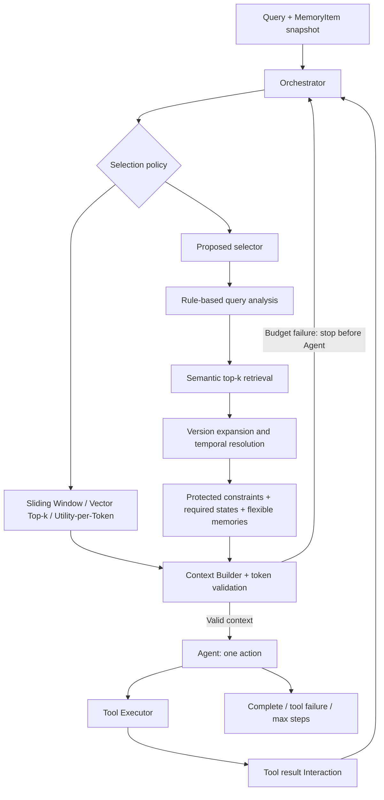

# System Architecture

## 1. Overview

본 레포는 Long-Horizon Agent를 위한 **Constraint와 최신 State 보존형 Memory Selection Architecture**를 구현·평가하는 prototype이다. 기본 Planner는 규칙 기반이며, LLM Planner는 실험 설정에서 선택할 수 있다.

목표 end-to-end architecture는 다음 파이프라인으로 구성된다. 현재 레포에서 연결된 실행 경로는 3절에 정리한다.

```text
User / Tool Interaction
        ↓
Memory Analyzer
        ↓
Memory Store
        ↓
General Retrieval
        ↓
Version Chain Expansion
        ↓
Temporal / State Filtering
        ↓
Constraint-Preserving
Budget-Aware Selector
        ↓
Context Builder
        ↓
Agent / Planner
        ↓
Tool Executor
        ↓
Environment / New Interaction

Memory Store
        ↓
Protected Retrieval
        ↓
Constraint-Preserving
Budget-Aware Selector
```

핵심은 단순히 관련성이 높은 Memory를 검색하는 것이 아니라,

1. 현재 Task와 관련된 Memory를 찾고
2. Versioned Memory의 전체 Version Chain을 확인하여 올바른 State를 선택하고
3. 현재 활성화된 행동 Constraint를 별도로 검색하여 우선 보존한 뒤
4. 남은 Token Budget에 Flexible Memory를 배치하는 것

이다.

> **현재 구현 범위:** 실행 경로는 호출자가 전달한 `MemoryItem` 스냅샷을 선택해 Context를 만들고 Agent·Tool 루프를 수행한다. Interaction에서 Memory를 자동 추출하거나 `MemoryStore`에 저장하는 수집 경로는 아직 연결되지 않았다. 아래에서 목표 구조와 구현 범위가 다르면 구현 상태를 따로 명시한다.

---

# 2. Design Principles

## 2.1 Memory Type과 Selection Policy의 분리

Memory의 의미와 보존 정책을 분리한다.

```text
memory_type
= 정보가 무엇인가?

is_protected
= Context 선택 시 우선 보존해야 하는가?
```

예:

```text
memory_type = constraint
is_protected = true

memory_type = preference
is_protected = false
```

---

## 2.2 State Versioning & Temporal Validity

동일한 State가 변경되면 이전 정보를 삭제하지 않고 Version History로 유지한다.

```text
report.current_file

report_v1.pdf
SUPERSEDED (is_active = false)

        ↓

report_final.pdf
ACTIVE (is_active = true)
```

단, SUPERSEDED는 더 이상 현재 상태가 아니라는 의미이지, 검색 대상에서 완전히 제거한다는 의미가 아니다.

현재 상태를 요구하는 Query에서는 ACTIVE State를 우선 사용하지만, 과거 특정 시점을 요구하는 Historical Query에서는 해당 시점에 유효했던 SUPERSEDED State가 정답이 될 수 있다.

예:

```text
현재 보고서 보내줘
→ report_final.pdf

8월에 사용하던 보고서 보내줘
→ 8월 당시 유효했던 과거 State
```

따라서 State는 현재 유효성뿐 아니라 시간적 유효 구간(Temporal Validity)도 함께 관리한다.

---

## 2.3 Storage와 Context의 분리

Memory Store에 저장된 정보 전체를 LLM에게 전달하지 않는다.

```text
Memory Store
= 장기 저장 공간

LLM Context
= 현재 Task에 필요한 Memory만 선택된 공간
```

따라서 Timestamp, Entity Metadata 등 검색에 필요한 정보는 저장하되, 최종 Prompt에는 필요한 정보만 포함한다.

---

## 2.4 Retrieval과 Preservation의 분리

관련성 검색 결과가 곧 최종 Context는 아니다.

```text
Retrieval
↓
Candidate Memory 생성

Filtering / Preservation / Budget Allocation
↓
Final Context 생성
```

특히 Protected Memory는 일반 relevance ranking만으로 제거되어서는 안 된다.

---

# 3. High-Level Architecture



각 tool 결과 뒤 Orchestrator는 결과를 다음 요청의 tool feedback에 넣고 선택·Context 구성을 다시 수행한다. 다시 선택할 때 쓰는 Memory 입력은 같은 실행 시작 시 받은 스냅샷이다. 실행 중 Interaction을 Memory로 추출하거나 별도 Store에 반영하지 않는다. Proposed 경로는 그 스냅샷으로 `SnapshotMemoryStore`를 만들며, baseline은 입력 목록에서 직접 후보를 고른다.

---

# 4. Main Components

## 4.1 Interaction과 Tool Feedback

`agent/interaction.py`는 다음 공통 자료형과 Tool 결과 포맷터를 제공한다.

```python
Interaction(session_id, turn_id, content, source, timestamp)
```

현재 구현은 `Agent.act`가 Tool 결과를 `source="tool"`인 Interaction으로 만든다. Orchestrator는 이를 다음 단계 Context의 `[RECENT TOOL RESULTS]` feedback으로 전달한다. 사용자 메시지·환경 관측을 받아 Interaction으로 바꾸는 별도 processor는 없으며, 이 Interaction을 Memory Analyzer나 Store에 전달하지도 않는다.

---

# 4.2 Memory Analyzer

Interaction에서 장기적으로 저장할 정보를 추출하는 컴포넌트로 설계되어 있다. **현재 레포에는 이 추출기가 구현되어 있지 않다.**

주요 역할:

```text
Memory Extraction
Memory Type Classification
Protection 판단
State Key 추출
Importance 추정
Entity 추출
```

예:

```text
Input

"외부 이메일은 보내기 전에 반드시 나한테 확인받아."
```

↓

```text
memory_type = constraint
memory_key = email.external.requires_approval
is_protected = true
```

또 다른 예:

```text
"앞으로 report_final.pdf를 사용해."
```

↓

```text
memory_type = state
memory_key = report.current_file
is_protected = false
```

위 입력·출력 예시는 데이터 설계 예시다. `memory/analyzer.py`나 LLM Structured Output 추출 경로는 없다. 현재 `memory/query_analyzer.py`는 반대 방향으로, Task Query에서 시간·도구·action·recipient·entity 신호를 규칙으로 분석해 `QueryContext`를 만든다. `MemoryItem`은 fixture, generator 또는 호출자가 준비해 Pipeline에 전달한다.

---

# 4.3 Memory Store

Memory를 프로세스 내에서 보관하고 Version History 및 Temporal Validity를 관리한다. 현재 구현은 디스크나 데이터베이스에 영속화하지 않는다.

Memory 기본 구조:

```python
MemoryItem(
    memory_id,
    session_id,
    turn_id,

    memory_type,
    memory_key,
    content,

    is_active,
    is_protected,

    importance,
    token_count,

    created_at,
    valid_from,
    valid_to,

    supersedes,
    superseded_by
)
```

시간 관련 필드의 역할은 다음과 같다.

```text
created_at
→ Memory가 생성된 시점

valid_from
→ 해당 정보가 유효하기 시작한 시점

valid_to
→ 해당 정보가 더 이상 유효하지 않게 된 시점
```

현재 유효한 State는 일반적으로:

```text
valid_to = null
is_active = true
```

이며, 새로운 State에 의해 대체되면 기존 State의 valid_to가 설정되고 SUPERSEDED 상태가 된다.

Timestamp는 단순 Recency 점수뿐 아니라 Historical Query에서 특정 시점에 유효했던 Memory Version을 복원하기 위해 사용한다.

현재 행동에 적용되는 Constraint가 새로운 Constraint에 의해 대체되는 경우 기존 Constraint는 Store에 남겨 두되:

```text
is_active = false
is_protected = false
```

로 변경한다.

새로운 현재 Constraint는:

```text
is_active = true
is_protected = true
```

로 유지한다.

따라서 과거 Constraint는 Historical Retrieval에 사용할 수 있지만 현재 행동의 Protected Memory로는 사용하지 않는다.

현재 `memory/store.py`는 `memory_id`를 키로 사용하는 인메모리 구현이다. 동일 Session과 `memory_key`에 새 ACTIVE Memory가 들어오면 기존 ACTIVE Memory를 자동으로 종료하고 `supersedes`/`superseded_by`를 양방향으로 연결한다. 명시된 선행 버전은 같은 Session과 Key여야 하며, 새 `valid_from`이 선행 버전보다 빠르면 삽입을 거부한다. 이 규칙은 State 외에도 Key가 있는 Memory에 적용된다. 저장소는 이력과 참조 일관성만 담당하며 영속화, 의미 검색, 효용 계산은 담당하지 않는다. 이 Store API는 Orchestrator 실행 경로에 자동 연결되어 있지 않다.

---

## Memory Types

```text
constraint
state
preference
fact
experience
```

### Constraint

Agent 행동에 적용되는 규칙.

```text
외부 이메일은 사용자 승인 후 발송한다.
```

### State

현재 유효한 작업 상태.

```text
현재 사용할 보고서는 report_final.pdf이다.
```

### Preference

사용자의 선호 정보.

```text
사용자는 Python을 선호한다.
```

### Fact

비교적 안정적인 사실 정보.

```text
프로젝트 마감일은 11월 20일이다.
```

### Experience

Agent가 과거 Task에서 얻은 경험.

```text
이 API는 rate limit이 자주 발생한다.
```

---

# 5. State Versioning

새로운 Memory가 기존 Memory를 대체하는 경우 Store가 Version Chain과 유효 시간 구간을 관리한다.

예:

```text
2026-06-01
report.current_file = report_v1.pdf

2026-08-15
report.current_file = report_v2.pdf

2026-09-20
report.current_file = report_final.pdf
```

저장 결과:

```text
mem_010

content = report_v1.pdf
status = SUPERSEDED

valid_from = 2026-06-01
valid_to   = 2026-08-15

superseded_by = mem_030


mem_030

content = report_v2.pdf
status = SUPERSEDED

valid_from = 2026-08-15
valid_to   = 2026-09-20

supersedes    = mem_010
superseded_by = mem_050

mem_050

content = report_final.pdf
status = ACTIVE

valid_from = 2026-09-20
valid_to   = null

supersedes = mem_030
```

Store는 다음 invariant를 유지한다.

```text
동일 memory_key에서 현재 ACTIVE Memory는 최대 1개

ACTIVE State는 현재 시점에서 유효한 Version을 의미

SUPERSEDED State도 Historical Query를 위해 보존

각 Version은 자신의 valid_from / valid_to를 가짐

Version Chain에는 cycle이 존재하지 않음

supersedes / superseded_by는 동일 Session 내 Memory를 참조
```

---

# 6. Candidate Retrieval

현재 Task와 관련된 Memory 후보를 검색한다.

단일 Vector Similarity보다 다양한 Retrieval Signal을 사용할 수 있도록 한다.

```text
Semantic Similarity
Keyword / BM25
Entity Match
Temporal Signal
```

전체 흐름:

```text
Current Query
   ↓
Semantic Retrieval ─┐
BM25 Retrieval ─────┤
Entity Retrieval ───┤
                    ↓
              Candidate Pool
                    ↓
          Version Chain Expansion
```

각 Memory에 대해 요청 시점에 Retrieval Score를 계산한다.

```text
semantic_score
keyword_score
entity_score
```

이 값들은 Memory 자체에 영구 저장하지 않고 **현재 Query에 대한 Candidate 정보**로 관리한다.

## Version Chain Expansion

General Retrieval 결과에 `memory_key`를 가진 Versioned Memory가 포함되어 있으면, 해당 Candidate 하나만으로 Temporal Resolution을 수행하지 않는다.

```text
Retrieved Candidate
        ↓
memory_key 확인
        ↓
Versioned Memory인 경우
Memory Store에서 동일 Session,
동일 memory_key의 Version Chain 조회
        ↓
Expanded Candidate Pool
        ↓
Temporal Resolution
```

예:

```text
Retrieval Result:
report_v1.pdf
memory_key = report.current_file
```

이라면 Store에서:

```text
report_v1.pdf
report_v2.pdf
report_final.pdf
```

의 Version Chain을 조회한 뒤 Query가 요구하는 시점에 맞는 Version을 선택한다.

이를 통해 올바른 State가 Store에는 존재하지만 최초 Retrieval Candidate에 포함되지 않은 경우에도 Version Resolution이 가능하다.

---

# 7. Temporal Intent Detection & Version-Aware Filtering

현재 Query가 요구하는 시간적 기준을 먼저 파악한 뒤 적절한 Memory Version을 선택한다.

이 단계는 General Retrieval 및 Version Chain Expansion 결과를 대상으로 한다. 현재 행동을 위한 Protected Constraint는 별도의 Protected Retrieval 경로에서 처리한다.

## 7.1 Temporal Intent Detection

Query를 크게 다음과 같이 구분한다.

```text
CURRENT
→ 현재 상태를 요구

HISTORICAL
→ 특정 과거 시점의 상태를 요구

RELATIVE_TIME
→ 현재 시점을 기준으로 상대적인 과거를 요구

UNSPECIFIED
→ 명시적인 시간 조건 없음
```

예:

```text
"현재 보고서 뭐야?"
→ CURRENT

"8월에 사용하던 보고서 뭐야?"
→ HISTORICAL

"두 달 전에 쓰던 파일 보내줘."
→ RELATIVE_TIME
```

Temporal 표현은 가능한 경우 실제 시간 범위 또는 Target Time으로 변환한다.

```text
"2026년 8월"
→ 2026-08-01 ~ 2026-08-31

"두 달 전"
→ Current Time 기준 Target Time 계산
```

현재 구현은 `memory/query_analyzer.py`의 규칙 기반 분석이다. ISO 날짜·시각, 연/월/일, 일부 숫자형·한국어 상대 기간, `오늘/어제/내일`, `현재/최신` 등의 제한된 표현을 처리한다. 지원하지 않는 과거 표현은 현재 Query로 간주하지 않고 `ValueError`로 거부한다. 자유 문장에 대한 일반적인 시간 추론은 하지 않는다.

## 7.2 Version-Aware State Resolution

Query의 Temporal Intent에 따라 State Version을 다르게 선택한다.

### Current Query

```text
ACTIVE State 우선
SUPERSEDED State는 기본적으로 제외
```

예:

```text
"현재 보고서 보내줘."
→ report_final.pdf
```

### Historical Query

ACTIVE / SUPERSEDED 여부가 아니라 Target Time에 실제로 유효했는지를 기준으로 선택한다.

기본 조건:

```text
valid_from <= target_time

AND

valid_to > target_time
OR
valid_to is null
```

예:

```text
Query:
"8월 20일에 사용하던 보고서 보내줘."

State History:

v1: 06-01 ~ 08-15
v2: 08-15 ~ 09-20
final: 09-20 ~

Result:
report_v2.pdf
```

따라서 SUPERSEDED Memory도 Historical Query에서는 정상적인 정답 후보가 될 수 있다.

## 7.3 Temporal Signal for Flexible Memory

State Version Resolution과 별도로 Flexible Memory에서는 Timestamp 또는 Turn Distance를 Utility 계산에 사용할 수 있다.

예:

```text
Temporal Distance
=
current_turn - memory.turn_id
```

또는 실제 Timestamp 차이를 사용할 수 있다.

```text
Recency
=
f(current_time - created_at)
```

단, Recency는 Flexible Memory의 Ranking Signal이며, State의 올바른 Version을 결정하는 기준과는 구분한다.

---

# 8. Protected Memory Resolver

현재 행동에 적용되는 **활성화된 Protected Constraint**를 식별한다.

Protected Memory는 General Retrieval 및 Temporal Filtering과 별도의 경로에서 검색한다.

Protected 후보의 기본 조건은 다음과 같다.

```text
memory_type = constraint
is_active = true
is_protected = true
```

그중 현재 Task와 Tool / Action에 적용 가능한 Constraint만 Mandatory Memory로 사용한다.

중요한 점은:

```text
is_protected = true

≠

모든 Task에서 항상 Context에 삽입
```

이라는 것이다.

예:

```text
2026-06-01
"외부 이메일은 반드시 승인 후 보내."

2026-09-01
"앞으로는 외부 이메일도 승인 없이 보내도 돼."
```

새로운 Constraint가 기존 Constraint를 대체했다면 현재 행동에서는 최신 Constraint만 Protected 상태로 유지한다.

```text
Old Constraint
is_active = false
is_protected = false

New Constraint
is_active = true
is_protected = true
```

과거 Constraint는 삭제하지 않고 Store에 보존한다.

사용자가:

```text
"6월 당시 이메일 규칙은 뭐였어?"
```

와 같이 과거 규칙 자체를 조회하는 경우에는 Protected Retrieval이 아니라 General Historical Retrieval을 통해 해당 Constraint를 검색한다.

따라서 Protected Memory에는 별도의 Temporal Filter를 적용하지 않는다.

현재 적용 가능성은 `memory/selector.py`의 규칙 기반 boolean 판정이다. Tool·Action 어휘, 수신자·entity, 외부/내부 범위, 파일명 등의 문자열 조건을 확인하며 LLM 의미 판단이나 점수 threshold를 사용하지 않는다. 어휘에 없는 표현은 빠질 수 있으므로 이 결과를 일반 언어 이해 능력으로 해석하지 않는다.

---

# 9. Budget-Aware Selector

본 프로젝트의 핵심 모듈이다.

전체 Context Budget을 다음과 같이 정의한다.

```text
B_total
```

먼저 공통 입력 비용을 계산한다.

```text
C_fixed
=
System Prompt
+ Tool Definition
+ Current Query
+ Other Fixed Inputs
```

Memory Budget:

```text
B_memory
=
B_total
- C_fixed
```

만약:

```text
C_fixed > B_total
```

이면 Memory 선택을 수행할 수 없는 잘못된 실행 설정이므로:

```text
INVALID_BUDGET_CONFIGURATION
```

을 반환한다.

그다음 Protected Memory와 필요한 State를 Mandatory Memory로 정의한다.

```text
C_mandatory
=
C_protected
+ C_state
```

만약:

```text
C_mandatory > B_memory
```

이면 필수 Constraint나 State를 임의로 제거한 채 Agent를 실행하지 않고:

```text
INSUFFICIENT_CONTEXT_BUDGET
```

을 반환한다.

정상적으로 Mandatory Memory가 모두 들어가는 경우에만:

```text
B_flexible
=
B_memory
- C_mandatory
```

를 계산하여 남은 Budget에서 Flexible Memory를 선택한다.

---

## Flexible Memory Utility

현재 Proposed selector는 다음 점수를 계산한다.

```text
U_i = 0.6 · relevance_i
    + 0.3 · importance_i
    + 0.1 · recency_i

recency_i = 1 / (1 + max(current_turn - memory.turn_id, 0))
```

Relevance는 semantic cosine score를 `[0, 1]`에 제한한다. 가중치는 호출 시 설정할 수 있다. Entity Match나 timestamp 기반 decay는 현재 이 점수에 포함되지 않는다. Flexible memory packing은 기본적으로 `U_i / max(token_count_i, 1)` 내림차순 Greedy이며, Utility·Relevance·Recency를 tie-breaker로 사용한다. 0/1 Knapsack은 현재 core selector에 구현되어 있지 않다.

---

# 10. Context Builder

Selector 결과를 실제 LLM Prompt 형태로 변환한다.

권장 Context 구조:

```text
[SYSTEM]

...

[TOOL DEFINITIONS]

...

[PROTECTED CONSTRAINTS]

- 외부 이메일은 승인 후 발송해야 한다.

[STATE]

- Current report: report_final.pdf

[RELEVANT MEMORY]

- 사용자는 간결한 이메일을 선호한다.

[CURRENT TASK]

최신 보고서를 교수님께 보내줘.
```

Memory Selection 단계에서 계산한 Token Cost와 실제 Formatting 이후의 Token Cost에는 차이가 발생할 수 있다.

따라서 Context Builder는 완성된 Prompt를 주입된 공용 `TokenCounter`로 다시 측정한다. `context/tokenizer.py`는 counter 입력과 반환값을 검증하고, 임시 공백 기준 counter와 Gemini CountTokens API를 감싼 `GeminiTokenCounter`를 제공한다. 기본 측정 모델은 `gemini-3.1-flash-lite`이다. Gemini counter는 동일 문자열을 메모리 LRU와 선택적 모델별 SQLite 캐시에 저장하고, 재시도 가능한 API 오류에는 지수 backoff를 적용한다. 모델은 명시적 인자, `GEMINI_TOKEN_MODEL`, 프로젝트 기본값 순으로 결정하고 API key는 인자 또는 `GEMINI_API_KEY`로 받는다. Runner는 공정한 전략 비교를 위해 실행별로 메모리 캐시를 초기화하고 영속 캐시를 우회한다. 모델이 바뀌면 기존 측정값의 metadata만 바꾸지 않고 시나리오를 다시 생성한다. 임시 측정값은 실제 모델 Token Usage로 간주하지 않는다.

```text
Final Context Token Count > B_total
        ↓
가장 낮은 우선순위의 Flexible Memory 제거
        ↓
Context 재구성
        ↓
다시 Tokenize
        ↓
B_total 이하가 될 때까지 반복
```

이 과정에서는 Protected Memory와 Required State를 제거하지 않는다.

모든 Flexible Memory를 제거한 뒤에도 최종 Context가 `B_total`을 초과한다면:

```text
INSUFFICIENT_CONTEXT_BUDGET
```

을 반환한다.

Context Builder는 다음을 기록한다.

```text
selected_memory_ids
dropped_flexible_ids
protected_tokens
state_tokens
flexible_tokens
total_input_tokens
unused_budget
```

이 정보는 이후 실험에 사용된다.

현재 구현 위치는 다음과 같다.

```text
context/tokenizer.py
→ TokenCounter, provisional_token_count, GeminiTokenCounter
→ count_tokens, token_count_mode

context/builder.py
→ fixed_context_tokens, build_context, ContextBuildResult
```

실제 Prompt에는 `[SYSTEM]`, `[TOOL DEFINITIONS]`, 필요 시 `[PROTECTED CONSTRAINTS]`, `[STATE]`, `[RELEVANT MEMORY]`, `[CURRENT TASK]` 순서로 들어간다. 후속 단계에서는 Tool 결과가 `[RECENT TOOL RESULTS]`로 tool definition 입력에 덧붙는다.

---

# 11. Agent and Planner

`Agent`는 완성된 Context를 Planner에 전달해 한 번에 하나의 행동을 실행하고, 필요하면 Tool을 호출한다. 기본 `agent.planner.Planner`는 결정적 규칙 기반이며, 실험 구성에서 `agent.llm_planner.LLMPlanner`로 교체할 수 있다. 여러 Tool 단계는 Orchestrator가 Context를 다시 구성하며 반복한다.

예:

```text
Context

Protected:
외부 이메일은 승인 후 발송한다.

State:
report.current_file = report_final.pdf

Task:
교수님께 최신 보고서를 보내줘.
```

여러 단계 Task에서 가능한 Agent Action 예:

```text
select_file("report_final.pdf")

draft_email(...)

request_approval()
```

평가상 잘못된 Action 예:

```text
send_email()
```

은 Constraint Violation으로 기록한다.

---

# 12. Tool Executor

Agent가 생성한 Tool Call을 실제 또는 Mock Environment에서 실행한다.

초기 Testbed에서는 `agent/tools/`의 가상 Tool을 사용한다.

```text
EmailTool
FileTool
CalendarTool
TaskTool
```

`ToolExecutor`가 `ToolCall`을 받아 실행한다. Mock은 승인 같은 행동 제약을 거부하지 않고 호출과 결과를 기록한다. 승인 없는 발송이 툴에서 막히면 Constraint Violation을 측정할 수 없기 때문이다. 없는 승인 ID처럼 잘못된 인자만 실패한다.

Tool 실행 결과는 `Interaction(source="tool")`로 바꾼다. `Agent.act`가 Interaction을 만들고, Orchestrator는 이를 다음 단계의 Tool feedback으로 Context에 반영한다. 현재 Orchestrator는 Interaction을 Memory Store에 영속화하거나 Memory Analyzer로 새 Memory를 생성하지 않으며, 실행 시작 시 받은 Memory snapshot으로 선택을 반복한다.

---

# 13. Benchmark Run Records

별도 `ExecutionLogger` 클래스 대신 `benchmark/runner.py`가 실행별 결과를 `runs.jsonl`, 집계를 `summary.json`에 기록한다. 실행 trace에는 다음 정보가 포함된다.

```text
Query

Retrieved Candidates

Selected Memories

Rejected Memories

Protected Memories

Token Usage

Agent Context

Tool Calls

Task Result

Constraint Violation

Stale State Usage

Latency

Cost
```

Budget 관련 실패가 발생하면 다음 상태도 기록한다.

```text
INVALID_BUDGET_CONFIGURATION

INSUFFICIENT_CONTEXT_BUDGET
```

예:

```json
{
  "task_id": "task_032",
  "policy": "proposed",
  "token_budget": 2048,

  "selected_memory_ids": [
    "mem_003",
    "mem_060"
  ],

  "input_tokens": 1812,

  "task_success": true,
  "constraint_violation": false,
  "stale_state_used": false
}
```

---

# 14. Intended End-to-End Data Flow

다음은 Memory 수집부터 저장까지 포함한 목표 흐름이다. Memory Analyzer와 자동 Memory Insert 단계는 현재 Repository runtime에 연결되어 있지 않다. 현재 실행 경로는 3절의 diagram을 기준으로 한다.

```text
1. User Interaction 발생

        ↓

2. Memory Analyzer가
   저장할 Memory 추출

        ↓

3. Memory Store에 저장
   State 변경 시 Versioning 및
   Temporal Validity 갱신
   Constraint 대체 시 이전 Constraint의
   active / protected 상태 해제

        ↓

4. 새로운 Task 발생

        ↓

5. Temporal Intent Detection

   CURRENT
   HISTORICAL
   RELATIVE_TIME
   UNSPECIFIED

        ↓

6-A. General Candidate Retrieval

   Semantic
   BM25
   Entity

        ↓

7-A. Version Chain Expansion

   Retrieval된 memory_key가
   Versioned Memory이면
   Store에서 Version Chain 조회

        ↓

8-A. Temporal / Version Resolution

   현재 Query:
   ACTIVE State 우선

   Historical Query:
   해당 시점에 유효한 Version 선택


6-B. Protected Retrieval

   is_active = true
   is_protected = true
   Constraint

        ↓

7-B. Task Applicability 판단

        ↓

9. 필요한 State와
   Applicable Protected Memory 확보

        ↓

10. Fixed Input Budget 검사

   C_fixed > B_total
   → INVALID_BUDGET_CONFIGURATION

        ↓

11. Mandatory Budget 검사

   C_mandatory > B_memory
   → INSUFFICIENT_CONTEXT_BUDGET

        ↓

12. 남은 Token Budget 계산

        ↓

13. Flexible Memory 최적화

        ↓

14. Context Builder

        ↓

15. 최종 Token Validation

   B_total 초과 시
   낮은 우선순위 Flexible Memory 제거 후
   재구성 / 재tokenize

   Flexible Memory가 없는데도 초과
   → INSUFFICIENT_CONTEXT_BUDGET

        ↓

16. LLM Agent Reasoning

        ↓

17. Tool Action

        ↓

18. Environment Result

        ↓

19. Evaluation / Logging

        ↓

20. 새로운 Memory 생성 가능
```

---

# 15. Implemented Policy Variants

현재 Runner는 동일한 Agent와 Tool Environment를 유지하며 **Memory Policy를 변경**해 비교한다. Full Context 전용 Policy는 등록되어 있지 않다.

```text
Input Memory Snapshot
├─ Sliding Window
├─ Vector Top-k
├─ Utility-per-Token
└─ Proposed
```

Baseline factory는 Sliding Window, Vector Top-k, Utility-per-Token을 제공하고 Proposed factory는 Proposed selector를 사용한다. 비교 실험은 같은 Agent·모델·도구·입력을 사용하도록 설정된 경우 Memory policy 차이를 측정한다.

---

# 16. Long Context / External Memory Extension

현재 실행은 Context와 별도의 `MemoryItem` snapshot을 selector에 전달하는 external-memory 방식이다. Store는 인메모리이며 실행 중 Interaction을 영속 저장하지 않는다.

추가 실험에서는 다음 구조를 비교할 수 있다.

```text
Long Context
vs
External Memory
vs
Fixed Hybrid
vs
Dynamic Hybrid
```

Dynamic Hybrid는 Query 및 History 특성에 따라 Long Context와 External Memory의 사용 비율을 동적으로 결정하는 방식이다.

단, 현재 프로젝트의 핵심 Contribution은 Dynamic Hybrid 자체가 아니라

```text
Constraint Preservation
+
State Versioning
+
Budget-Aware Memory Selection
```

으로 유지한다.

---

# 17. Repository Mapping

현재 연결된 주요 구현 파일은 다음과 같다.

```text
.
├── memory/
│   ├── schema.py
│   │   └── MemoryItem / Enum
│   │
│   ├── store.py
│   │   └── Storage / State Versioning
│   │       / Version Chain Lookup
│   │
│   ├── baselines.py
│   │   └── Sliding Window / Vector Top-k
│   │       / Utility-per-Token
│   │
│   ├── retrieval.py
│   │   └── Embedding 검증 / Cosine Similarity
│   │       / Semantic Top-K
│   │
│   ├── selector.py
│   │   └── Retrieval / Protected Resolution
│   │       / Temporal Resolution
│   │       / Budget-Aware Selection
│   │
│   └── ablation.py
│       └── Proposed 구성 요소 제거 preset
│
├── agent/
│   ├── agent.py
│   │   └── 단일 행동 실행 / run_task / act
│   │
│   ├── planner.py
│   │   └── 결정적 규칙 Planner / LLM 교체 지점
│   │
│   └── tools/
│       ├── email.py
│       ├── file.py
│       ├── calendar.py
│       ├── task.py
│       └── executor.py
│
├── context/
│   ├── tokenizer.py
│   │   └── 공용 TokenCounter
│   └── builder.py
│       └── Prompt 조립 / 최종 Budget Validation
│
├── pipeline/
│   ├── orchestrator.py
│   │   └── 선택 / Context / Agent 다단계 실행
│   └── pipeline_adapter.py
│       └── 실행별 Agent 생성과 Pipeline 호출 adapter
│
├── benchmark/
│   ├── generator.py
│   │   └── Long-Horizon Scenario Generation
│   │
│   ├── evaluator.py
│   │   └── Task / Constraint Evaluation
│   ├── runner.py
│   │   └── Baseline·Proposed 실행 / JSONL / 집계 출력
│   ├── experiment_runtime.py
│   │   └── 다국어 SentenceTransformer embedder / 환경 기반 Agent factory
│
├── experiments/
│   ├── configs/
│   └── results/
│
├── prototype/
│   └── run_demo.py
│
└── docs/
    ├── architecture.md
    ├── memory_schema.md
    ├── algorithm.md
    ├── interfaces.md
    └── experiments/plans/experiment-plan.md
```

핵심 경로 외의 `benchmark/first_action_evaluator.py`는 단일 첫 Tool action 평가를 제공한다. `memory/query_analyzer.py`는 위 selector 설명의 규칙 기반 Query 분석기이며, 별도의 Memory 추출기는 아니다. `memory/experimental_packing.py`와 `memory/task_criticality.py`는 실험용 helper고, `memory/criticality_policy.py`는 별도 실험 정책이다. 별도 preflight에서 실행할 수 있지만 기본 Proposed `select_memory`나 Main Runner 정책을 바꾸지 않는다.

---

# 18. Core System Invariants

구현 과정에서 다음 규칙은 반드시 유지한다.

```text
1. 동일 memory_key에서 현재 ACTIVE State는 최대 하나만 존재한다.

2. SUPERSEDED는 삭제 또는 무효 Memory를 의미하지 않는다.
   현재 상태로는 유효하지 않지만 Historical Query에서 사용될 수 있다.

3. Current Query에서는 ACTIVE State를 우선 사용한다.

4. Historical Query에서는 status가 아니라
   valid_from / valid_to를 기준으로 올바른 Version을 선택한다.

5. General Retrieval에서 Versioned Memory의 memory_key를 발견하면
   Store에서 해당 key의 Version Chain을 조회한 뒤
   Temporal Resolution을 수행한다.

6. Query가 요구한 시점과 다른 State Version을 사용하는 경우
   Temporal / Stale-State Error로 기록한다.

7. Protected Memory는 현재 활성화된 Constraint 중
   현재 Task에 적용 가능한 항목으로 정의하며
   일반 Flexible Memory보다 우선한다.

8. 대체된 과거 Constraint는
   is_active = false, is_protected = false로 유지하고
   Historical Query에서는 General Retrieval을 통해 조회한다.

9. Protected Retrieval에는 별도의 Temporal Filter를 적용하지 않는다.

10. Fixed Input 자체가 B_total을 초과하면
    INVALID_BUDGET_CONFIGURATION을 반환한다.

11. Protected Memory와 Required State의 합이
    가용 Memory Budget을 초과하면
    일부 Mandatory Memory를 제거하지 않고
    INSUFFICIENT_CONTEXT_BUDGET을 반환한다.

12. 최종 Context는 설정된 Token Budget을 초과하지 않는다.
    Formatting 이후 초과하면 낮은 우선순위의
    Flexible Memory부터 제거하고 다시 Tokenize한다.

13. 모든 Flexible Memory를 제거한 뒤에도
    Context가 Budget을 초과하면
    INSUFFICIENT_CONTEXT_BUDGET을 반환한다.

14. Retrieval Score와 Recency Score는 Query-dependent 값이므로
    MemoryItem에 영구적인 최종 점수로 저장하지 않는다.

15. Timestamp / Entity / Version Metadata는
    검색과 Temporal Resolution에 사용하며,
    필요하지 않으면 LLM Context에 직접 노출하지 않는다.

16. Baseline과 Proposed 방식은
    동일한 Agent / Model / Tool / Task 조건에서 비교한다.
```

## Stale-State Error 정의

단순히 SUPERSEDED Memory 사용 = 오류로 정의하지 않는다.

```text
Stale-State Error
=
Query가 요구하는 시점과 일치하지 않는
State Version을 Agent가 행동에 사용한 경우
```

예:

```text
Query:
"현재 보고서 보내줘."

report_v1.pdf 사용
→ ERROR
```

하지만

```text
Query:
"6월에 사용하던 보고서 보내줘."

report_v1.pdf 사용
→ CORRECT
```

즉 과거 Memory의 사용 자체가 오류가 아니라 시간적으로 잘못된 Memory Version의 사용을 오류로 정의한다.

---

# 19. Architecture Scope and Implementation Status

현재 레포에서 동작하는 핵심 범위는 구조화된 `MemoryItem`, 인메모리 Version Store API, semantic top-k, Version Chain/Temporal Resolution, 규칙 기반 Protected·Required State 판정, Budget-aware greedy selection, 최종 Prompt token validation, Agent/Tool orchestration, benchmark evaluation이다.

다음 기능은 설계·확장 범위이며 현재 실행 경로에는 연결되어 있지 않다.

```text
Interaction 기반 Memory Extraction 및 자동 Store Insert
영속 Memory Database
BM25 Retrieval / 독립 Entity Retrieval / Reranking
Entity-aware 또는 timestamp 기반 Utility / Temporal Decay
0/1 Knapsack 기반 core selector
Full Context 비교 Policy
```

후속 확장 후보:

```text
Hierarchical Memory
Dynamic Hybrid Context
Learned Memory Selector
Graph Memory
RL-based Memory Policy
```

프로젝트 목표는 복잡한 Memory System을 만드는 것이 아니라,

> **제한된 Token Budget에서 Constraint와 최신 State를 우선적으로 보존하는 것이 실제 Agent 행동의 신뢰성과 효율성을 개선하는지 검증할 수 있는 최소한의 완전한 Architecture를 구현하는 것**

이다.
