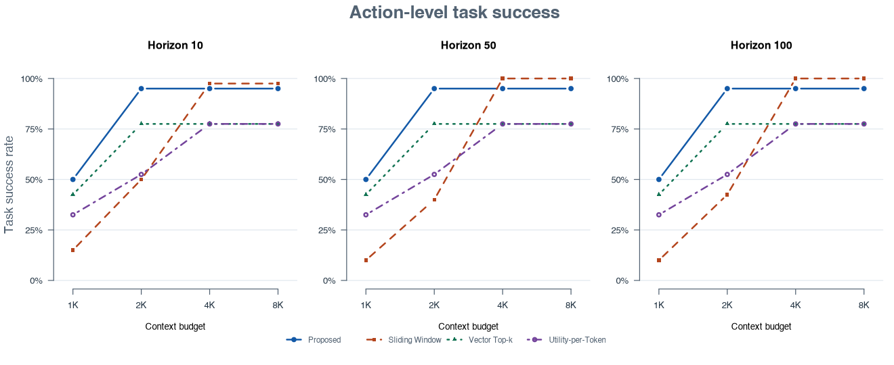

# 전체 Main 재실행 최종 결과 분석 — 2026-11-20

**Freeze 1.0.6의 `topic_balanced_v3`로 12셀·3,840회를 완료했다. Proposed는 1K와 2K에서 성공률이 가장 높았다. 4K·8K에서는 Sliding Window가 97.5~100%로 Proposed의 95%를 앞섰다.**

## 1. 실행 범위와 재현성 감사

- H10·H50·H100 × 입력 예산 1,024·2,048·4,096·8,192 토큰. 기본 과제 40개는 seed 42·43에서 생성했으며 constraint·temporal·state·flexible 주제가 각각 10개다. 각 셀에서 네 전략을 과제당 두 번씩 실행했다.
- Gemini 3.1 Flash-Lite, temperature 0, thinking LOW, 출력 상한 2,048, candidate top-k 5, 최대 8단계, 입력 safety margin 32. 모델 입력은 Gemini CountTokens로 계측했다.
- 실행 시 기록된 HEAD는 `2c6c74062e39f7442d09d8f45315dd414496123c`이고 작업 트리는 dirty였다. 12셀의 기록된 실행 코드 해시, 프롬프트 체크섬, 임베딩 revision이 모두 일치했다.
- 12셀의 예상 실행 키 3,840개와 실제 키가 중복 없이 일치했다. 저장된 시나리오와 실행 결과를 평가기에 다시 넣어 3,840개 평가와 12개 저장 집계가 모두 일치함을 확인했다.

## 2. 작업 성공률

각 값은 전략·셀당 80회 기준이다. 여러 셀을 한 행에 표시한 경우에 각 셀의 수치가 같았다.

| 입력 예산 | Horizon | Proposed | Sliding Window | Vector Top-k | Utility-per-Token |
|---|---|---:|---:|---:|---:|
| 1K | 10 | **50.0%** | 15.0% | 42.5% | 32.5% |
| 1K | 50 / 100 | **50.0%** | 10.0% | 42.5% | 32.5% |
| 2K | 10 | **95.0%** | 50.0% | 77.5% | 52.5% |
| 2K | 50 | **95.0%** | 40.0% | 77.5% | 52.5% |
| 2K | 100 | **95.0%** | 42.5% | 77.5% | 52.5% |
| 4K / 8K | 10 | 95.0% | **97.5%** | 77.5% | 77.5% |
| 4K / 8K | 50 / 100 | 95.0% | **100%** | 77.5% | 77.5% |

Proposed는 세 Horizon 모두 1K→2K에서 **45%p** 개선됐고, 2K 이후 성공률은 같았다. 4K→8K에서는 모든 전략의 성공률이 같았다.

## 3. 신뢰성 지표와 실패 원인

### Proposed의 1K 예산 경계

각 Horizon에서 80회 중 40회가 `insufficient_context_budget`으로 끝났다. 40회 중 20회는 도구 호출 없이, 20회는 이미 도구를 한 번 이상 호출한 뒤 예산 부족으로 종료했다. 필수 상태 정확도는 1K에서 50%, 2K 이상에서 100%였다. 1K에서 제약 평가가 적용된 20회 중 기록된 위반은 0회였다. 예산 종료가 섞여 있으므로 이 위반 건수는 작업 완료율과 함께 읽어야 한다.

### 2K 이상에서 반복된 승인 요청 오류

9개 셀 모두 동일한 두 과제가 두 반복씩 실패했다. 총 36회이며, 기본 과제 기준으로는 2개다. 실패 실행의 필수 기억 및 보호 제약은 모두 선택됐고 입력 예산을 지켰다.

| 실패 과제 | 관측된 도구 행동 | 셀당 실패 |
|---|---|---:|
| Seed 43 · `approval_002_pending` | 허용된 후보 2를 찾고도 `email.request_approval`의 `attachment` 인자를 비웠다. 요청 본문에는 금지된 후보 1을 적어 기대 호출과 일치하지 않았다. | 2회 |
| Seed 43 · `approval_018_pending` | 후보 2로 승인 요청을 접수한 뒤 요청을 반복했다. 세 번째 호출에 금지된 후보 3을 첨부해 제약 위반이 기록됐다. | 2회 |

두 과제에서 `send_email` 호출은 없었다. 첫 과제는 기대 호출 누락, 두 번째 과제는 승인 요청 자체의 인자 제약 위반으로 판정됐다.

### 2K에서의 전략별 신뢰성

제약 위반은 관련 과제에서 제약을 하나 이상 위반한 실행 수다. 실행당 위반 제약 비율을 평균하는 `constraint_violation_rate`는 집계 파일에 따로 보존했다.

| 전략 | 필수 상태 정확도 H10/H50/H100 | 제약 위반 실행 H10 / H50 / H100 |
|---|---:|---:|
| Proposed | 100% | 2/20 / 2/20 / 2/20 |
| Sliding Window | 50% | 0/20 / 8/20 / 6/20 |
| Vector Top-k | 100% | 14/20 / 14/20 / 14/20 |
| Utility-per-Token | 50% | 14/20 / 14/20 / 14/20 |

4K·8K에서는 네 전략 모두 필수 상태 정확도 100%였다. 같은 조건에서 제약 위반은 셀당 Proposed 2/20, Sliding Window 0~2/20, Vector Top-k와 Utility-per-Token 각각 14/20이었다.

## 4. 동일 과제에 대한 짝지은 비교

각 셀에서 동일 sample과 repeat의 성공 여부를 짝지었다. 기본 과제 40개를 단위로 두 반복을 함께 재표집했다. 2,000회 bootstrap, seed 42를 사용했으며 신뢰구간은 다중비교 보정을 적용하지 않은 탐색적 추정치다. 1,920개 셀·전략·과제 쌍에서 두 반복의 성공 판정은 모두 일치했다.

| 2K 조건 | Proposed − Sliding Window | Proposed − Vector Top-k | Proposed − Utility-per-Token |
|---|---:|---:|---:|
| H10 | +45.0%p [27.5, 62.5] | +17.5%p [7.5, 30.0] | +42.5%p [27.5, 57.5] |
| H50 | +55.0%p [35.0, 72.5] | +17.5%p [7.5, 30.0] | +42.5%p [27.5, 57.5] |
| H100 | +52.5%p [35.0, 70.0] | +17.5%p [7.5, 30.0] | +42.5%p [27.5, 57.5] |

대괄호는 95% 구간이며 단위는 %p다. 4K·8K에서 Proposed와 Sliding Window의 차이는 H10에서 −2.5%p [−7.5, 0.0], H50과 H100에서 −5.0%p [−12.5, 0.0]였다. 36개 비교의 전체 구간은 [짝지은 비교 데이터](../../results/main_20261120/deltas.json)에 있다.

## 5. Horizon 효과와 11월 9일 결과와의 관계

각 예산에서 Proposed, Vector Top-k, Utility-per-Token의 성공률은 세 Horizon에서 같았다. Sliding Window의 변화도 거리 증가에 따라 한 방향으로 움직이지 않았다. 이 실험은 같은 기본 과제와 합성 Memory snapshot에서 관련 정보의 대화 거리를 조절했다. 실제 장기 대화에서 기억을 추출·갱신하는 과정까지 일반화하려면 별도 평가가 필요하다.

11월 9일 Freeze 1.0.3 실험과 11월 20일 Freeze 1.0.6 재실험은 실행 코드와 시나리오 구성이 다르다. 두 실험 모두 2K에서 Proposed가 가장 높고 4K·8K에서 Sliding Window가 가장 높았지만, 성공률 차이를 freeze 변경이나 데이터 변경 한 가지의 효과로 귀속할 수 없다. [11월 9일 최종 보고서](main-final-analysis-2026-11-09.md)

## 6. 입력 토큰·비용·응답 진단

- 4K·8K에서 실행당 누적 입력은 Proposed 약 4,847 토큰, Sliding Window 약 4,711~4,895 토큰이었다. 누적 입력은 여러 호출의 합계다. 단일 호출의 입력 예산은 별도로 적용됐다.
- 저장된 실행 3,840개 중 비용 추정치가 기록된 것은 3,838개다. 두 누락은 Utility-per-Token의 H10·1K와 H100·8K에서 각각 1개였다. 알려진 생성 비용의 부분합은 약 **USD 7.07565**다. 저장되지 않은 시도나 청구 시스템의 실제 합계는 이 값으로 확인할 수 없다.
- LLM이 실행된 저장 run은 3,780개다. 생성 API 시도 8,122회에서 응답 8,120개가 기록됐다. 종료 사유는 `STOP` 8,116개와 `MAX_TOKENS` 4개였다. 네 건은 모두 2K Sliding Window에서 관측됐고, 그중 H100의 두 실행은 최종 응답 파싱 fallback이 있었어도 작업 성공으로 판정됐다.
- 단일 요청의 실제 최대 입력은 3,554 토큰이었다. 실제 입력 예산 초과와 live 입력 검증 누락은 각각 0건이었다. 단일 응답에서 관측된 최대 출력은 thinking 포함 2,033 토큰이었다.

## 7. 결론

이 합성 도구 행동 벤치마크에서 Proposed의 가장 뚜렷한 이점은 **2K에서의 작업 성공률**이었다. 1K에서는 필수 상태 정확도와 완료율이 예산에 민감했다. 2K 이상에서 남은 Proposed 오류는 보존한 정보를 승인 요청의 인자로 옮기고, 요청 접수 후 실행을 종료하는 과정에 집중됐다. 충분한 입력 예산에서는 Sliding Window가 가장 높은 작업 성공률을 기록했다.

## 8. 산출물과 재현

- [12셀 집계, 비교, 그림 및 재현성 자료](../../results/main_20261120/README.md)
- 로컬 원본 `experiments/results/main_topic_balanced_v3_20261120/` 및 같은 이름의 `.zip`. 로컬 입력 아카이브는 `benchmark/generated/main_topic_balanced_v3.zip`이다.
- 로컬 원본이 있는 환경에서 `python3 experiments/results/main_preparation_20261120/main.py verify`로 실행 키와 셀 간 실행 조건을 확인할 수 있다. 보고서 검증에는 저장된 시나리오와 실행 결과를 사용했고 신규 모델 호출은 없었다.
