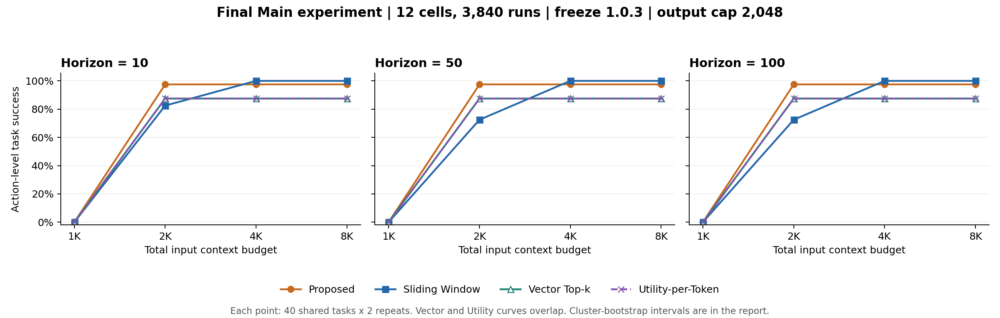

# Main 최종 실험 검토용 자료 — 2026-11-09

H10/H50/H100 × 1K/2K/4K/8K의 12셀, 3840회 결과를 검토하기 위한 소형 집계 자료다.
기본 과제는 40개이며 각 셀·전략당 같은 과제의 두 반복 80회다.
실행 소스는 commit `5d00c6d5a8c3c9348ed872a9899d107b027c0196`, freeze 1.0.3이다.

- `summary.json`: 정규 Evaluator의 전략/셀 48개 집계와 sample-cluster 95% CI.
- `deltas.json`: 정규 Evaluator의 Proposed−Baseline 36개 paired 비교.
- `config.json`: 실행·집계에 사용한 canonical Main 설정.
- `metric_roles.json`: 사전에 정의한 주요·효율·진단 지표 구분.
- `provenance_audit.json`: 12셀 embedding revision 감사 결과. 경로는 저장소 상대 경로로 변환했다.
- `validation.json`: 전체 실행 키·재평가 일치·코드/입력 해시와 비용 불완전 3개 사례.
- `budget_horizon_success.png`, `.svg`: 전체 성공률 그림.

## 보존 범위

원본 `runs.jsonl`과 12개 `experiment.json`은 기존 .gitignore 정책에 따라
`experiments/results/main_phase*/`와 `experiments/results/main_final_20261109/`에
로컬 보존했다. 이 디렉터리는 대용량 원본 로그를 포함하지 않는다.
따라서 집계와 해시를 리뷰할 수 있지만, 이 자료만으로 원본 실행 전체를 재평가할 수는 없다.
원본이 필요한 검토에는 별도 아티팩트 전달이 필요하다.

완료된 실행 3840회 중 비용이 완전한 것은 3837회다. 알려진 비용의 부분합
$6.5465375를 실제 총청구액으로 보고하지 않는다. 비용 누락은 null로 유지하며
Task Success에는 해당 실행 결과를 포함한다.

[최종 분석 보고서](../../main_final_analysis_20261109.md)와
[실험 계획·전체 결과](../../experiment_plan.md#17-전체-main-최종-결과-2026-11-09)를 함께 읽는다.
