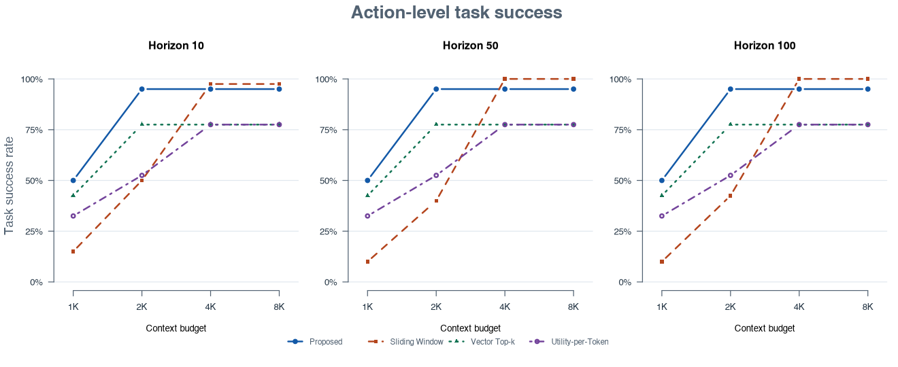

# Main 재실행 검토용 자료 — 2026-11-20

Freeze 1.0.6, `topic_balanced_v3`, 12셀·3,840회. 각 전략·셀은 기본 과제 40개의 두 반복으로 구성된다. [최종 분석 보고서](../../experiments/reports/main-final-analysis-2026-11-20.md)

| 파일 | 내용 |
|---|---|
| [summary.json](summary.json) | 정규 평가기의 전략·셀 집계 48개와 sample-cluster 95% 구간 |
| [deltas.json](deltas.json) | Proposed와 세 비교 전략의 짝지은 작업 성공률 차이 36개 |
| [config.json](config.json) | 실행에 사용한 Main 설정 |
| [metric_roles.json](metric_roles.json) | 주요 성능, 효율, 진단 지표의 구분 |
| [provenance_audit.json](provenance_audit.json) | 셀별 입력·원본·집계·코드·프롬프트 해시, 임베딩 revision |
| [validation.json](validation.json) | 원본 재평가 일치, 예산 및 비용 진단, 제약 위반 실행 수 |
| [budget_horizon_success.svg](budget_horizon_success.svg) | 작업 성공률 그림의 벡터 형식 |

원본 실행 로그, 실행 메타데이터 및 아카이브는 `experiments/results/main_topic_balanced_v3_20261120/`와 같은 이름의 `.zip`에 로컬 보존했다. 이 페이지에서 집계와 해시를 검토할 수 있다. 전체 원본 재평가에는 원본 파일이 필요하다. 비용이 기록된 3,838회의 추정 부분합과 두 누락 사례는 검증 자료와 최종 분석 보고서에 기록했다.
